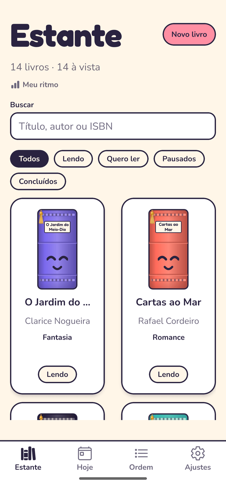
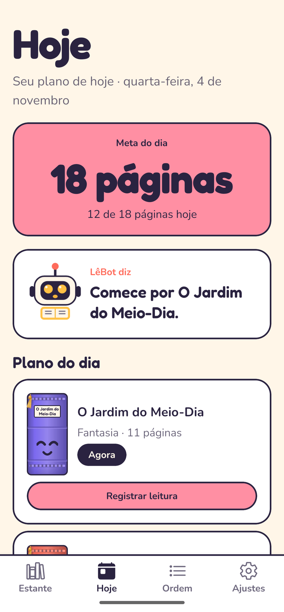
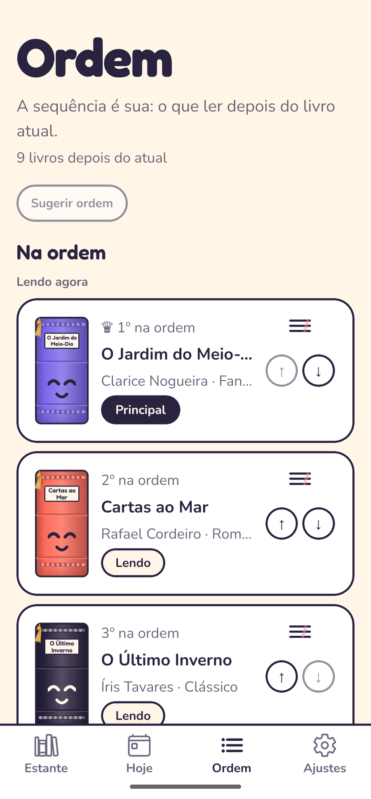
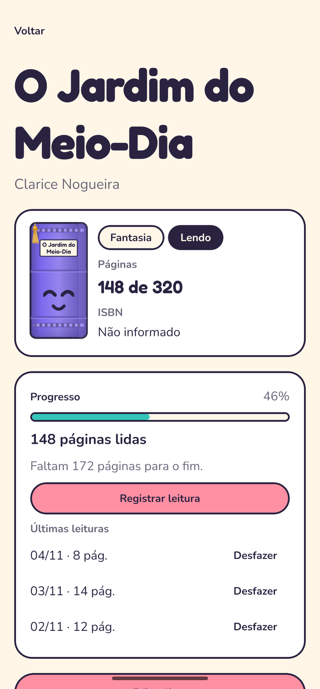
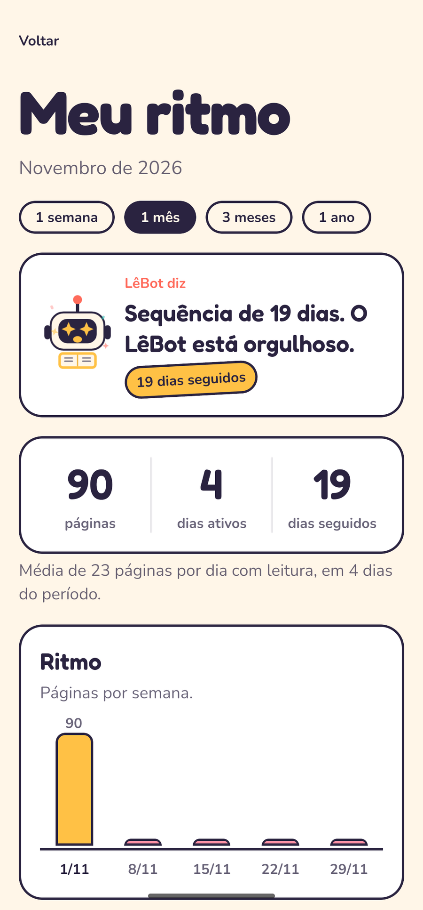
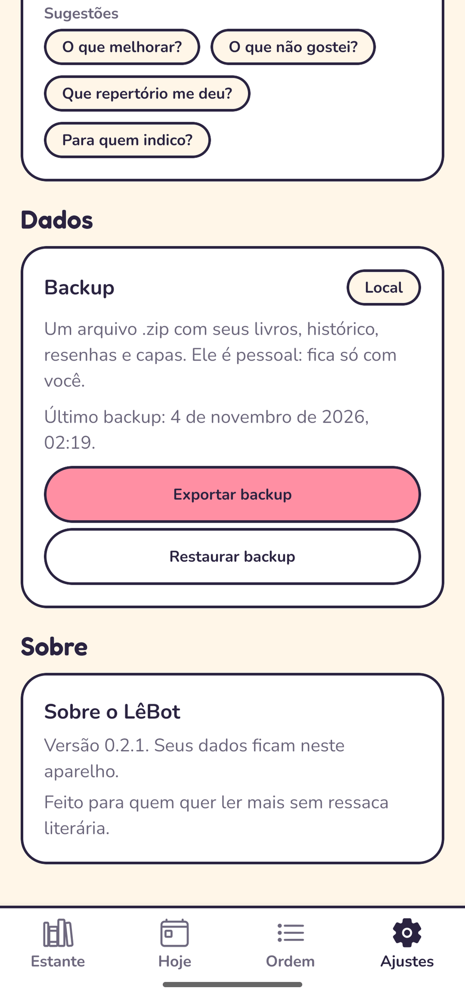

<div align="center">
  
  <h1>LêBot</h1>
  <p><strong>Sua estante respeita o seu ritmo.</strong></p>
  <p>Catálogo, ordem de leitura e um plano diário que evita ressaca literária —<br/>
  offline, sem conta e sem telemetria.</p>

  <p>
    <a href="https://github.com/francisN7/LeBot/actions/workflows/ci.yml"></a>
    <a href="https://github.com/francisN7/LeBot/releases"></a>
    
    
    
  </p>
</div>

## Dedicatória

> **Para a minha amada esposa.** O LêBot nasceu de uma ideia sua: uma estante que
> respeita o ritmo de quem lê, uma ordem que não pesa e um plano diário que evita
> a ressaca literária. Você idealizou tudo isso; eu só escrevi o código. Este app
> é, antes de tudo, para você. Te amo.

| Estante | Hoje | Ordem |
|---|---|---|
|  |  |  |
| **Detalhe** | **Meu ritmo** | **Ajustes** |
|  |  |  |

## O que é

- **Estante:** seus livros com capa ou lombada 3D por gênero e status, busca sem
  acento e filtros.
- **Hoje:** um plano pequeno e possível, calculado no aparelho. Meta editável,
  volta leve depois de dias sem ler e sugestão sem cobrança.
- **Ordem:** a sequência é sua. O primeiro "Lendo" é o principal; os outros vêm
  depois, com arrastar ou setas.
- **Sem culpa:** livro pausado ou abandonado é escolha válida. O app não insiste.

O plano é deterministicamente calculado e testado — sem IA, sem nuvem e sem
surpresa. A estante, a ordem e o histórico ficam no SQLite do aparelho.

## Baixar

O APK fica na página de [**Releases**](https://github.com/francisN7/LeBot/releases).

- Android 7.0+ (arm64 e armv7), ~54 MB.
- Instale por cima para atualizar: a assinatura é a mesma e seus dados ficam.
- Ainda não há Play Store nem iOS.

## Como funciona

**Estante.** Cada livro vira uma lombada: a cor é o gênero, o rosto é o status.
Com capa, a foto ganha profundidade de livro. Toque longo no chip abre a roda de
status.

**Hoje.** O motor recebe a meta, os livros, as sessões e a sua ordem. Ele respeita
o primeiro "Lendo", alterna gêneros, limita cada livro a 60% da meta e reduz o dia
para 70% se você ficou 3 dias sem ler. O plano não é salvo: é recalculado a cada
abertura.

**Ordem.** Todo livro não concluído entra automaticamente, em dois blocos:
"Lendo agora" e o resto. O primeiro "Lendo" é o principal. Reordenar não muda o
status.

**Resenha e ritmo.** Ao concluir, você pode dar nota, escrever e guardar uma
citação. "Meu ritmo" mostra páginas, dias ativos, sequência, gêneros e notas por
semana, mês, 3 meses ou ano.

**Backup.** Exporte um `.zip` com livros, histórico, resenhas e capas para a
pasta que quiser. Restaurar substitui tudo; o arquivo é seu e não sai do
aparelho por conta própria.

## Privacidade

Seus dados ficam **só no aparelho**. Não há conta, servidor, analytics ou
crash reporting. O plano é calculado offline. O único arquivo que sai é o backup
que você exportar.

Leia [`docs/reference/security-privacy.md`](docs/reference/security-privacy.md).

## Para devs

**Requisitos:** Node 22 (`.nvmrc`), npm e Expo Go no Android (ou o APK de
release para medir desempenho).

```bash
npm install
npm start          # Metro + QR code
npm run android    # emulador/aparelho conectado
```

| Comando | Para quê |
|---|---|
| `npm run lint` · `npm run typecheck` | Biome e TypeScript |
| `npm run test` · `npm run test:watch` | Jest (517 testes) |
| `npm run docs:check` | links e orçamento da documentação |
| `npm run doctor` | `expo-doctor` |
| `gh workflow run release.yml` | APK de release no GitHub Actions |

```text
src/app/            rotas (Expo Router), sem lógica de negócio
src/features/       UI, hooks e serviços por feature
src/db/             schema Drizzle, client, migrações, seed e repositórios
src/components/ui/  componentes genéricos e arte vetorial
src/theme/          tokens de design
src/lib/            funções puras
docs/               guias, referência, ADRs e roadmap
```

O build de release **nunca** roda na máquina local: o workflow compila, confere a
assinatura e as permissões e publica no GitHub. Instruções em
[`docs/guide/release.md`](docs/guide/release.md).

Documentação: comece pelo mapa em [`docs/README.md`](docs/README.md). As regras
para agentes e contribuições estão em [`AGENTS.md`](AGENTS.md), as decisões em
[`docs/adr/`](docs/adr/) e o futuro em
[`docs/roadmap/main.md`](docs/roadmap/main.md).

## Marca e licença

O código e a arte estão sob [MIT](LICENSE). A identidade do LêBot — nome, mascote
e logo — é marca do projeto: forks são bem-vindos, mas devem trocar nome e
identidade visual.

## English

LêBot is a personal, offline-first Android reading app. Catalog your books, keep
a reading order, and get a small daily plan that avoids reading burnout.
Everything stays on the device (SQLite) — no account, no telemetry, no server.
Built with Expo, React Native, TypeScript, Drizzle and NativeWind. Download the
APK in [Releases](https://github.com/francisN7/LeBot/releases); docs start at
[`docs/README.md`](docs/README.md).
